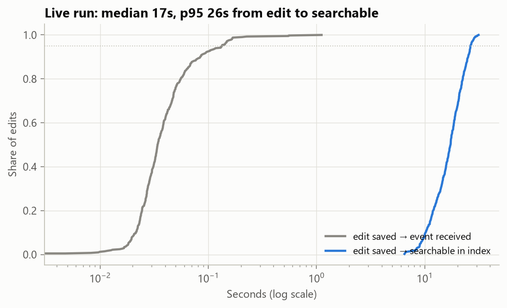
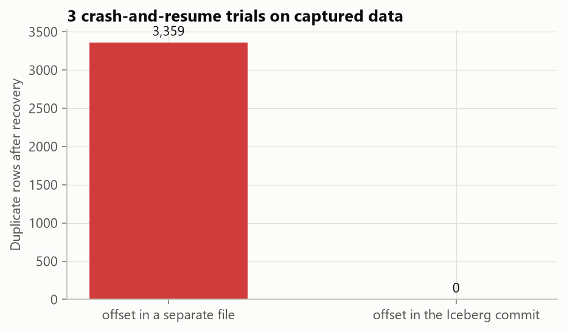
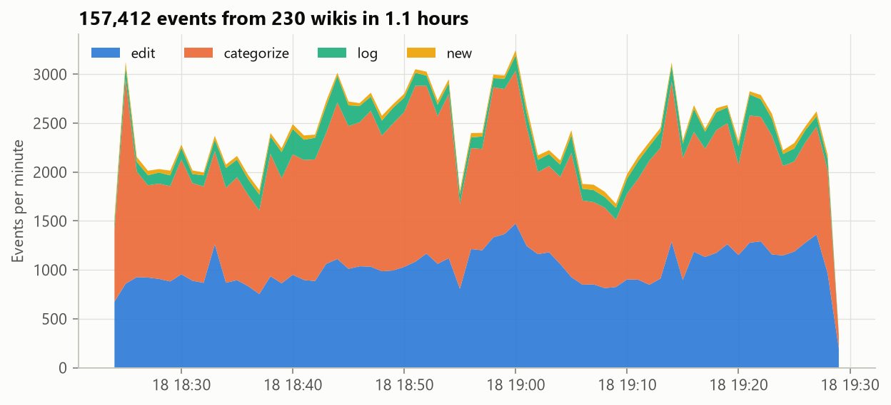
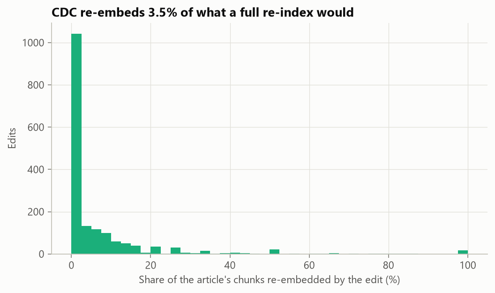
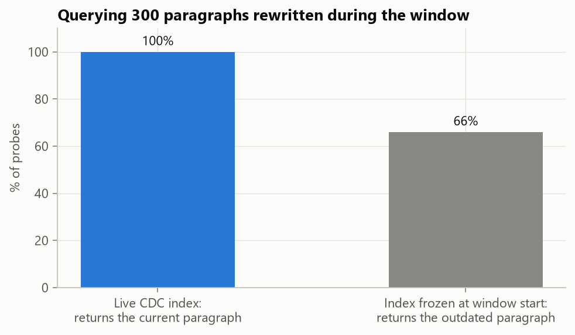
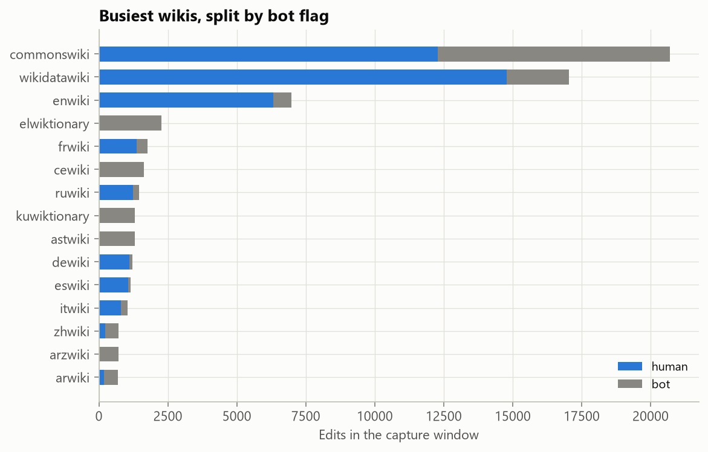

# A live Wikipedia lakehouse that keeps a RAG index fresh

   

A retrieval-augmented LLM answers from whatever its index held at the last rebuild. When the source keeps changing, the answers go stale between rebuilds, and rebuilding the whole index on every change wastes most of the embedding work. This project connects to Wikipedia's public edit stream (about 40 events a second from every Wikimedia wiki) and runs it through three layers:

1. **A lakehouse.** Raw edit events land in Apache Iceberg tables (bronze, silver, gold), including a history of every article's revisions, built incrementally with exactly-once guarantees.
2. **Change data capture.** For English Wikipedia articles, each new revision is diffed paragraph by paragraph against what the index already holds.
3. **A RAG index.** Only changed paragraphs are re-embedded into LanceDB. Old versions are closed rather than deleted, so the index can answer "what does the article say now?" and "what did it say at time T?".

**Result:** in a 15-minute live run, a Wikipedia edit became searchable in the index **17 seconds after it was saved (median; 26 s at p95)**. Over 1,714 replayed article edits, change-data capture embedded **1,455 chunks where a full re-index would have embedded 41,087, a 96.5% saving**, and the index still matched a fresh chunking of every article exactly (1,001 of 1,001). Asked about 300 paragraphs rewritten during the capture, the live index always returned the current text. An index frozen at the start of the window returned the outdated paragraph 66% of the time.



## Results at a glance

| Measure | Value |
|---|---|
| Events captured (live, 18:24–19:29 SAST, 18 Oct 2026) | 157,412 from 230 wikis, 40.3 per second |
| Stream lag, edit saved → event received (median) | 0.07 s (after a 1.27 s clock-offset correction) |
| Replay through bronze → silver → gold | 29 micro-batches of ~5,400 events, 2.0 s each (median), 2,865 events/s |
| Lake integrity checks | bronze = landing (157,412 rows); silver IDs unique; gold hourly totals = silver; SCD2: 3,385 articles, one current row each, 0 interval gaps |
| Crash test: duplicates after recovery, offset in a separate file | **3,359 rows** over 3 trials |
| Crash test: duplicates after recovery, offset in the Iceberg commit | **0 rows**, 0 files missing |
| Index: articles tracked / edits applied | 1,000 / 1,714 (+ 981 baseline revisions) |
| Chunks embedded: full re-index vs CDC | 41,087 vs **1,455 (96.5% saved)** |
| Edits that changed no prose at all (references, infobox, templates) | 54% |
| Index vs source consistency | 1,001 of 1,001 articles match exactly |
| Live run (15 min, 300 tracked articles) | 414 edits indexed; latency p50 **17.3 s**, p95 **26.5 s**, max 31.4 s |

## The pipeline

```
Wikimedia EventStreams (SSE)
  │  resumable consumer: Last-Event-ID = Kafka offsets
  ▼
landing/ dt=…/hour=…/part-*.jsonl     at-least-once: atomic file rename, then checkpoint
  │
  ▼  exactly-once micro-batches (offset stored in the Iceberg commit)
bronze.recentchange        every event, typed columns + raw JSON, hidden hour partitioning
  ▼
silver.edits               edits and page creations, deduplicated by event ID; bot, anonymous and revert flags; lag
  ├──► gold.wiki_hourly            per wiki and hour: edits, bots, reverts, editors, bytes (recomputes touched hours only)
  └──► gold.article_revisions      SCD2: one row per revision with valid_from / valid_to / is_current
          │
          ▼  change data capture (enwiki articles)
       MediaWiki API (fetch by revision ID, cached) ► wikitext → paragraphs ► diff against live chunks
          ▼
       LanceDB chunks             WordLlama embeddings; closed rows keep history for as-of queries
```

All tables are Apache Iceberg, written with [PyIceberg](https://py.iceberg.apache.org/) to a local warehouse with a SQLite catalog, and queried with DuckDB. Nothing needs a cluster or a running server.

### How exactly-once works without Spark or Flink

Each step stores its read position *inside* the Iceberg commit that carries its data:

- bronze's last landing file name;
- silver's last bronze batch;
- gold's last silver batch.

These go in the snapshot summary (`wikistream.landing.last-file`, for example). An Iceberg commit is atomic, so there are only two crash cases. A crash before the commit leaves the table untouched, with orphan data files but no rows. A crash after the commit has already moved the offset. A re-run therefore neither loses nor repeats data. The Spark and Flink Iceberg sinks use the same design.

The crash test measures the alternative most hand-written pipelines use, an offset file saved after the commit. Three trials kill ingestion on real captured data, once before a commit and once after one, then resume. With the separate offset file, each crash after a commit re-ingests the batch it just committed (1,044 to 1,198 duplicate rows per trial). With the offset in the commit there are none.



The stream consumer itself is at-least-once by design. Its checkpoint is the SSE `Last-Event-ID`, which holds Wikimedia's Kafka offsets. During the capture, the consumer process died (out of memory while another job ran) and was restarted 10 minutes later. It resumed from the checkpoint and the stream replayed the missed events: 8,988 edits arrived more than a minute late. The per-minute event counts show no gap at 19:00–19:10, and bronze holds exactly the 157,412 landed events.



### Change data capture into the index

- **Fetch by revision ID.** The MediaWiki API returns the exact text an editor saved, 50 revisions per call, so a replay months later sees the same text. Responses are cached on disk and re-runs make no API calls.
- **Baseline first.** The first time an article appears, the revision *before* the captured edit is indexed as a baseline, so every captured edit is applied as a real diff.
- **Paragraph chunks with content hashes.** Wikitext is parsed with `mwparserfromhell`. References, file links, templates and reference-style sections are dropped, and each paragraph becomes a chunk keyed by a hash of its section and text. Fixed-size windows would shift every later chunk when a sentence is inserted. Paragraph boundaries are where edits naturally stop.
- **Diff, then one atomic merge per batch.** Chunks that disappeared get `valid_to` set, new chunks are embedded and inserted, and unchanged chunks are left alone. All of it is one LanceDB `merge_insert` keyed on a row ID.
- **Replays are no-ops.** A revision already in the index log, or older than what the index shows for that article, is skipped. Re-applying a batch after a crash changes nothing (tested).

Most edits barely touch the text a RAG system retrieves. 54% changed no paragraph at all: reference, infobox, category or template edits. The 794 edits that did change prose re-embedded a median of 7.7% of their article, about one paragraph in thirteen.



### Why freshness matters: as-of retrieval

Because closed chunks stay in the table, `valid_from <= T < valid_to` reconstructs the index as it was at any time T. This makes a clean experiment. Each of 300 paragraphs rewritten during the window is used as a query twice: against the live index, and against the same index as of the window start, which is what a nightly rebuild would still be serving. The live index returned the new paragraph for all 300. The frozen index returned the old version of that paragraph for 66% of them, and some other part of the same article for most of the rest. Those are the answers a RAG system would give from outdated text.



### Where the 17 seconds go

The event reaches the consumer in under 0.1 s. The rest is design choice: landing files flush every 10 s, the pipeline cycle starts every 15 s, and a cycle takes 4.5 s (median), split between the lake update (1.9 s) and the index update (2.2 s, including the MediaWiki API call). Smaller flush and cycle intervals would cut the median roughly in proportion, at the cost of more and smaller Iceberg files.

## What the stream shows

| | |
|---|---|
| Event types | 77,299 category changes, 67,546 edits, 9,828 log actions, 2,739 page creations |
| Busiest wikis | Wikimedia Commons (20,708 edits, 41% bots), Wikidata (17,044), English Wikipedia (6,971) |
| Bot share of all edits | 33.6%; some small wikis are almost entirely bots (Greek Wiktionary 99%, Chechen Wikipedia 99%) |
| English Wikipedia articles | 4,916 edits to 3,385 articles; 11.5% by anonymous or temporary accounts, 4.3% reverts |
| Contested articles (3+ reverts in the window) | 6, led by *2026 French student protests* (18 edits, 4 reverts, 6 editors) |



Tables: [`top_wikis.csv`](reports/tables/top_wikis.csv), [`enwiki_contested_articles.csv`](reports/tables/enwiki_contested_articles.csv), [`event_types.csv`](reports/tables/event_types.csv). Editor user names are not published.

## Limitations

- **Scaled to a laptop.** About an hour of capture, 1,000 tracked articles in the replay and 300 in the live run. Every Wikipedia edit is captured and modelled in the lake, but only edits to tracked articles are fetched and embedded.
- **Small files.** One micro-batch is one commit, so the SCD2 table, maintained by copy-on-write upserts, reached 303 data files in an hour. A production deployment would run Iceberg compaction (`rewrite_data_files`) and snapshot expiry on a schedule.
- **The index commit is idempotent, not transactional with the lake.** The CDC driver saves its position after the index commit. A crash between the two replays the batch, which the index then skips. Effectively exactly-once, but by a different mechanism from the lake.
- **Revert detection reads English edit summaries**, so revert analytics are reported for English Wikipedia only. MediaWiki's change tags would be more reliable but are not in the recentchange stream.
- **Freshness probes use the new paragraph as the query.** That makes the live index's 100% close to guaranteed. The informative number is what the frozen index returns for the same query.
- **Latency is measured against this machine's clock,** corrected by the 1.27 s offset implied by negative stream lags.

## Reproduce

```bash
pip install -r requirements.txt
python scripts/capture_landing.py --minutes 60      # live capture into data/landing (resumable)
python scripts/run_pipeline.py                      # replay → lake, CDC index, crash test, report
python scripts/run_live.py --minutes 15 --fresh     # live freshness run, then: run_pipeline.py --skip replay index crash
pytest -q                                           # 10 tests, no network or captured data needed
```

Captured data, the lake, the index and the revision cache stay in `data/`, which is git-ignored (217 MB of landing JSON compresses to a 52 MB Iceberg lake).

## Repository structure

```
├── scripts/
│   ├── capture_landing.py    live capture into the landing zone
│   ├── run_pipeline.py       replay, CDC index, crash test, report
│   └── run_live.py           capture + lake + index together, for freshness
├── src/wikistream/
│   ├── stream.py             resumable SSE consumer (Last-Event-ID)
│   ├── landing.py            atomic JSONL landing files + checkpoint
│   ├── lakehouse.py          Iceberg bronze/silver/gold, watermarks in snapshot summaries, SCD2
│   ├── content.py            MediaWiki revision fetch + cache, wikitext → paragraph chunks
│   ├── index.py              LanceDB chunk index: CDC apply, as-of search, revision log
│   ├── cdc.py                silver → index driver with baselines
│   ├── experiments.py        replay timing, crash test, live run
│   ├── report.py             DuckDB analytics, checks, probes, figures
│   └── config.py
├── tests/test_wikistream.py
└── reports/                  figures, tables, metrics.json, RESULTS.md
```

## References

- Wikimedia [EventStreams](https://wikitech.wikimedia.org/wiki/Event_Platform/EventStreams_HTTP_Service) and the [recentchange schema](https://schema.wikimedia.org/repositories/primary/jsonschema/mediawiki/recentchange/latest.yaml).
- [Apache Iceberg spec](https://iceberg.apache.org/spec/): snapshots, hidden partitioning, atomic commits.
- Armbrust et al. (2020). *Delta Lake: High-Performance ACID Table Storage over Cloud Object Stores.* VLDB.
- Kleppmann (2017). *Designing Data-Intensive Applications*, ch. 11 (stream processing, exactly-once).
- Lewis et al. (2020). *Retrieval-Augmented Generation for Knowledge-Intensive NLP Tasks.* [arXiv:2005.11401](https://arxiv.org/abs/2005.11401)
- Wikipedia text is available under [CC BY-SA 4.0](https://creativecommons.org/licenses/by-sa/4.0/); this repository publishes article titles and statistics only.
